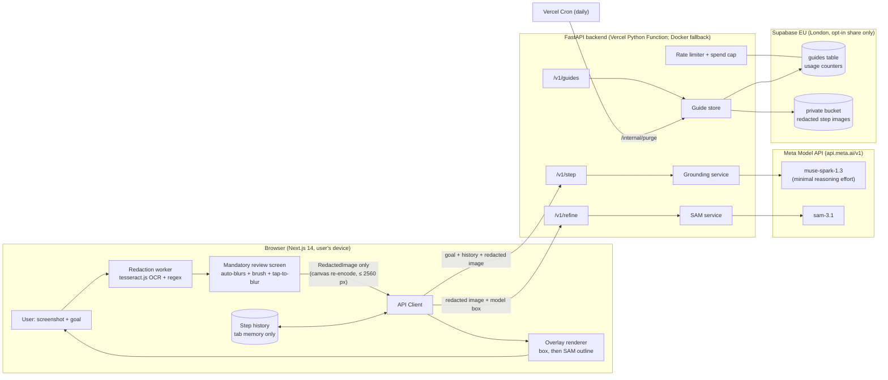

# ShowMe

> Screenshot + goal → one highlighted step at a time on your own screen. Private details are hidden in your browser before upload.

ShowMe is an on-screen assistant built for the **Meta Global AI Developer Hackathon (Indie track)**. It uses **`muse-spark-1.3`** for vision grounding and **`sam-3.1`** for segmentation outlines via the Meta Model API.

- **Live Web App**: [https://showme-web-delta.vercel.app](https://showme-web-delta.vercel.app)
- **Live API Health**: [https://showme-api-xi.vercel.app/v1/healthz](https://showme-api-xi.vercel.app/v1/healthz)
- **Evaluation Dashboard**: [https://showme-web-delta.vercel.app/eval](https://showme-web-delta.vercel.app/eval)

---

## 1. What ShowMe Does

When people get stuck on complex websites or software settings, text manuals and generic chatbots are difficult to follow. ShowMe gives users **one visual step at a time**:
1. **Screenshot & Goal**: Add a screenshot of what is currently on screen and state what you want to do (e.g. "cancel my subscription").
2. **On-Device Redaction**: Client-side OCR + regex auto-hides emails, phone numbers, payment card numbers, UK postcodes, and IBANs. A mandatory review screen lets the user tap or brush to obscure anything private. The raw unredacted image never leaves the device.
3. **Step & Refinement**: The redacted screenshot is sent to `muse-spark-1.3` to identify the single next action. If `sam-3.1` segmentation agrees with the model bounding box, a precise outline highlight is drawn; otherwise, the bounding box is shown.
4. **Follow & Progress**: Tap the highlighted element on your screen, take the next screenshot, and repeat until the task is complete.
5. **Opt-in Sharing**: Optionally share a completed step-by-step guide with family or customers via a 7-day auto-expiring private link.

---

## 2. Architecture

Thin, stateless FastAPI backend; all privacy-sensitive redaction occurs client-side in the browser before any network transmission; Meta models handle visual understanding.



### Data Storage & Privacy Boundary

| Data | Browser | Backend Memory | Backend Logs / Disk | Supabase Storage | Meta API |
| :--- | :--- | :--- | :--- | :--- | :--- |
| **Raw screenshot** | Yes (in memory only) | **Never** | **Never** | **Never** | **Never** |
| **Redacted image** | Yes | Request lifecycle | **Never** | Only if shared (7-day TTL) | Per request (Standard mode, not used for training) |
| **Goal text** | Yes | Request lifecycle | **Never** (length only) | Only if shared | Per request |
| **Step instructions** | Yes | Request lifecycle | **Never** | Only if shared | Output generated |
| **IP address** | N/A | Request lifecycle | **Never** | Salted daily hash for rate limits (48 h TTL) | N/A |
| **Usage / Spend metrics** | N/A | N/A | Request latency, status, tokens, cost | Daily counter bucket | N/A |

---

## 3. Privacy Invariants

- **Private by Construction (PRIV-1)**: Raw screenshot bytes never reach the network. The TypeScript API client strictly requires a branded `RedactedImage` symbol generated solely by `lib/redaction/redact.ts`. Verified by Playwright network interception tests.
- **Mandatory Human Review (PRIV-2)**: No API request can be dispatched until the user inspects the redacted screenshot on the review screen and clicks Continue. Cannot be skipped or disabled.
- **Zero Content Logging (PRIV-3)**: The backend never logs screenshots, instructions, goal strings, or raw IP addresses.
- **Ephemeral (PRIV-4)**: Screenshots and session history exist in tab memory only; no tracking cookies, IndexedDB, or localStorage caches.
- **Standard Mode Only (PRIV-6)**: Strictly uses Meta API standard mode. Contributor-mode models (`*-contributor`) are completely banned to guarantee content rights remain with the user.

---

## 4. Measured Evaluation Results

Every figure below is generated directly from output logs in `eval/results/` and matches [`RESULTS.md`](eval/results/RESULTS.md) and [`report.md`](eval/results/2026-11-01-e2e-final/report.md):

| Suite | Dataset / Split | Model | n | Accuracy | Metric |
| :--- | :--- | :--- | :--- | :--- | :--- |
| **ScreenSpot-v2** | Held-out (test) | `muse-spark-1.3` (minimal) | 1,172 | **90.7%** | Point inside ground-truth control box |
| **ScreenSpot-Pro** | Held-out (stratified) | `muse-spark-1.3` (minimal) | 300 | **63.7%** | Point inside control (high-res desktop/web) |
| **ScreenSpot-Pro** | Held-out (stratified) | `muse-wonder-1.0` (minimal) | 300 | **66.7%** | Point inside control (+3.0 pts at ~3× cost) |
| **Negatives Suite** | Held-out probes | `muse-spark-1.3` (minimal) | 222 | **64.4%** | Correctly stated `not_visible`, `unsure`, or `refuse` |
| **E2E 20-Task Suite** | Real live websites | `muse-spark-1.3` + `sam-3.1` | 20 | **70.0% (14/20)** | Full multi-step task completion (avg 3.7 steps) |

*Full evaluation reports and raw predictions: [`eval/results/RESULTS.md`](eval/results/RESULTS.md) and [`eval/results/2026-11-01-e2e-final/report.md`](eval/results/2026-11-01-e2e-final/report.md).*

---

## 5. Known Limitations

In keeping with our transparency principles:
1. **Free-form Text Inputs**: Regex covers structured PII (emails, cards, phones, postcodes, IBANs), but unstructured personal text (names, custom notes) depends on the user's manual brush on the review screen.
2. **Dense Desktop Interfaces**: Accuracy drops to 63.7% on high-resolution professional software (ScreenSpot-Pro) with tightly packed toolbars.
3. **Live Web E2E Failure Modes**: 6 of 20 live web tasks failed due to anti-bot defenses (e.g. Royal Mail Access Denied), stubborn third-party cookie consent banners, and file download triggers without in-page success states.
4. **Mobile Browser OCR**: Laptop Chrome OCR executes in 106–214 ms; mid-range mobile phone browser OCR timing has not been verified in the field yet (marked **not run** per RULES.md transparency policy rather than estimated).

---

## 6. Development & Quickstart

### Prerequisites
- Python 3.11+ with [`uv`](https://github.com/astral-sh/uv)
- Node.js 20+ with [`pnpm`](https://pnpm.io/)
- Meta Model API key (`MODEL_API_KEY`) in `.env` (copy from `.env.example`)

### Commands

```bash
# Install dependencies for web, backend, and eval
make setup

# Run local development servers (Web on :3000, API on :8000)
make dev

# Run unit and integration tests (backend pytest + eval pytest + web vitest)
make test

# Run linters and typecheckers (ruff, mypy strict, eslint, tsc)
make lint

# Run Playwright browser test suite (41 tests, including axe accessibility checks)
pnpm --filter web test:e2e

# Run the 10-sample live grounding smoke test (~$0.05)
make smoke

# Run evaluation harness
make eval SUITE=screenspot-v2 [N=100] [MODEL=muse-spark-1.3] [EFFORT=minimal]
```

---

## 7. Project Structure

```text
showme/
├── apps/web/                 # Next.js 14 App Router, TypeScript strict, Tailwind CSS
│   ├── app/                  # Pages: /, /app, /eval, /g/[token]
│   ├── components/           # UI components, Overlay, A11yControls, GuideStepper
│   └── lib/redaction/        # tesseract.js worker, PII regex patterns, canvas redact
├── backend/                  # FastAPI backend (Vercel Python Function & local Docker)
│   ├── showme/core/          # Pure Python logic: prompts, schema, grounding, SAM, pricing
│   ├── showme/api/           # FastAPI routes: /v1/step, /v1/refine, /v1/guides
│   └── migrations/           # 001_guides.sql (Supabase RLS & counter tables)
├── eval/                     # Evaluation harness for ScreenSpot & 20-task E2E suite
│   ├── showme_eval/          # Evaluation runner, metrics, cache, calibration
│   ├── e2e/                  # Playwright 20-task automated suite and task definitions
│   └── results/              # Immutable evaluation logs, predictions, and spend records
├── docs/                     # PRD, ARCHITECTURE, DESIGN, RULES, REQUIREMENTS, PHASES, MEMORY
└── .learnings/               # Daily founder briefings, interview Q&A drills, step log
```

---

## 8. Licence & Citations

- **Licence**: MIT — see [LICENSE](LICENSE).
- **Meta Models**: Grounding powered by `muse-spark-1.3`; segmentation outlines powered by `sam-3.1`.
- **Benchmark**: ScreenSpot dataset (Cheng et al., 2024).
