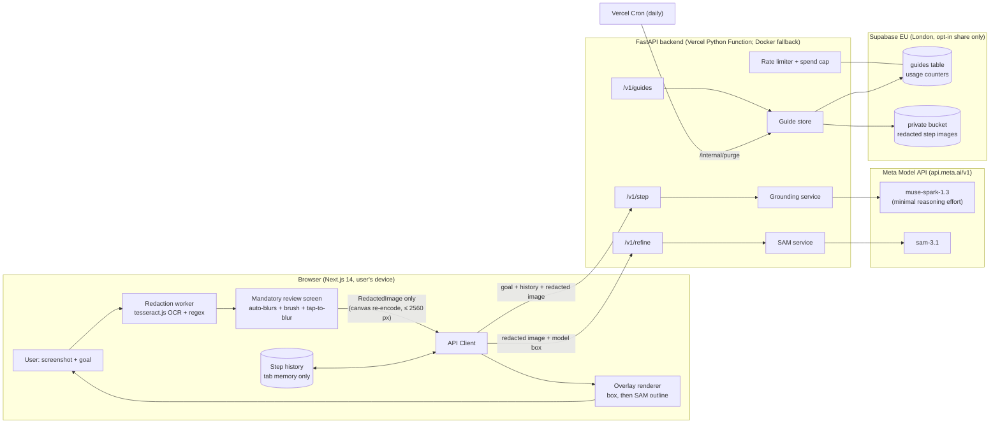

# ShowMe

> Screenshot + goal → one highlighted step at a time on your own screen. Private details are hidden in your browser before upload.

ShowMe is an on-screen assistant built for the **Meta Global AI Developer Hackathon (Indie track)**. It uses **`muse-spark-1.3`** for vision grounding and **`sam-3.1`** for segmentation outlines via the Meta Model API.

- **Live Web App**: [https://showme-web-delta.vercel.app](https://showme-web-delta.vercel.app)
- **Live API Health**: [https://showme-api-xi.vercel.app/v1/healthz](https://showme-api-xi.vercel.app/v1/healthz)
- **Evaluation Dashboard**: [https://showme-web-delta.vercel.app/eval](https://showme-web-delta.vercel.app/eval)

---

## 1. What ShowMe Does

When an older relative or friend gets stuck on an app or website, phone calls are painful ("What do you see now?") and remote desktop tools compromise privacy.

ShowMe is built for **the remote helper**:
When someone you help sends you a screenshot on WhatsApp or Messages, you drop it into ShowMe with what they want to do. ShowMe finds the exact button or link, auto-masks private details client-side, and generates an **ephemeral 7-day step-by-step guide** you can send back. They open the link on their phone or tablet, follow one clean visual highlight at a time at their own pace, and the guide self-destructs after 7 days.

Confident self-helpers can also use ShowMe directly for their own tricky screens (cancelling subscriptions, complex government forms, obscure privacy settings).

1. **Screenshot & Goal**: Add a screenshot of what is currently on screen and state what you want to do (e.g. "cancel my subscription").
2. **On-Device Redaction**: Client-side OCR + regex auto-hides emails, phone numbers, payment card numbers, UK postcodes, and IBANs. A mandatory review screen lets the user tap or brush to obscure anything private. The raw unredacted image never leaves the device.
3. **Step & Refinement**: The redacted screenshot is sent to `muse-spark-1.3` to identify the single next action. If `sam-3.1` segmentation agrees with the model bounding box, a precise outline highlight is drawn; otherwise, the bounding box is shown.
4. **Follow & Progress**: Tap the highlighted element on your screen, take the next screenshot, and repeat until the task is complete.
5. **Opt-in Sharing**: Share a step-by-step guide with family or customers via an auto-expiring 7-day private link. Guides can be shared starting right from Step 1.

---

## 2. Competitive Differentiation: What Only ShowMe Does

Visual grounding and UI overlays are active areas (e.g. Microsoft Copilot Vision Highlights, Google Gemini Live, enterprise Digital Adoption Platforms). Here is why ShowMe is architecturally distinct:

| Capability / Invariant | ShowMe | Microsoft Copilot Vision (Highlights) | Google Gemini Live | Enterprise DAPs (WalkMe, Pendo) |
| :--- | :--- | :--- | :--- | :--- |
| **Client-Side Pre-Upload Redaction** | **Yes** (WASM OCR + regex + user review; raw bytes never leave device) | No (streams raw frames to Microsoft cloud) | No (streams live video/audio to Google cloud) | No client redaction (runs in DOM) |
| **Zero Install / Any Platform** | **Yes** (pure web app; any screenshot from iOS, Android, Mac, Windows) | No (Windows 11 US only, desktop app) | No (Pixel 10 / Android app ecosystem) | No (requires enterprise app code injection) |
| **Shareable Expiring Guides** | **Yes** (7-day self-destructing links for remote relatives) | No (live session only) | No (live session only) | No (enterprise license only) |
| **Radical Transparency & Error Reporting** | **Yes** (reports `not_visible` and refusals; all benchmark & failure logs public) | No (uncalibrated confidence, opaque failures) | No (opaque conversational steering) | N/A (rule-based DOM selectors) |

*Sources: Copilot Vision Highlights announced for Windows 11 US ([Microsoft Windows Experience Blog, June 2025](https://blogs.windows.com/windowsexperience/2025/06/12/copilot-vision-on-windows-with-highlights-now-available-in-us/)); Gemini Live camera overlays ([TechBriefly, August 2025](https://techbriefly.com/2025/08/21/google-gemini-live-adds-visual-overlays-and-a-new-audio-model/)). "One minute vs 20-minute phone call" represents our estimated product UX goal.*

---

## 3. Architecture

Thin, stateless FastAPI backend; all privacy-sensitive redaction occurs client-side in the browser before any network transmission; Meta models handle visual understanding.



### Data Storage & Privacy Boundary

| Data | Browser | Backend Memory | Backend Logs / Disk | Supabase Storage | Meta API |
| :--- | :--- | :--- | :--- | :--- | :--- |
| **Raw screenshot** | Yes (in memory only) | **Never** | **Never** | **Never** | **Never** |
| **Redacted image** | Yes | Request lifecycle | **Never** | Only if shared (7-day TTL) | Per request (Standard mode, not used for training) |
| **Goal text** | Yes | Request lifecycle | **Never** (length only) | Only if shared | Per request |
| **Step instructions** | Yes | Request lifecycle | **Never** | Only if shared | Output generated |
| **IP address** | N/A | Request lifecycle | **Never** | Salted daily hash for rate limits (48 h TTL) | N/A |
| **Usage / Spend metrics** | N/A | N/A | Request latency, status, tokens, cost | Daily counter bucket | N/A |

---

## 4. Privacy Invariants

- **Private by Construction (PRIV-1)**: Raw screenshot bytes never reach the network. The TypeScript API client strictly requires a branded `RedactedImage` symbol generated solely by `lib/redaction/redact.ts`. Verified by Playwright network interception tests.
- **Mandatory Human Review (PRIV-2)**: No API request can be dispatched until the user inspects the redacted screenshot on the review screen and clicks Continue. Cannot be skipped or disabled.
- **Zero Content Logging (PRIV-3)**: The backend never logs screenshots, instructions, goal strings, or raw IP addresses.
- **Ephemeral (PRIV-4)**: Screenshots and session history exist in tab memory only; no tracking cookies, IndexedDB, or localStorage caches.
- **Standard Mode Only (PRIV-6)**: Strictly uses Meta API standard mode. Contributor-mode models (`*-contributor`) are completely banned to guarantee content rights remain with the user.

---

## 5. Measured Evaluation Results

Every figure below is generated directly from output logs in `eval/results/` and matches [`RESULTS.md`](eval/results/RESULTS.md) and [`report.md`](eval/results/2026-11-01-e2e-final/report.md):

| Suite | Dataset / Split | Model | Prompt | n | Accuracy | Metric |
| :--- | :--- | :--- | :--- | :--- | :--- | :--- |
| **ScreenSpot-v2** | Held-out (test) | `muse-spark-1.3` (minimal) | v1 | 1,172 | **90.7%** | Point inside ground-truth control box |
| **ScreenSpot-Pro** | Held-out (stratified) | `muse-spark-1.3` (minimal) | v1 | 300 | **63.7%** | Point inside control (high-res desktop/web) |
| **ScreenSpot-Pro** | Held-out (stratified) | `muse-wonder-1.0` (minimal) | v1 | 300 | **66.7%** | Point inside control (+3.0 pts at ~3× cost) |
| **Negatives (Honesty)** | Held-out absent probes | `muse-spark-1.3` (minimal) | v1 | 210 | **62.4%** | Correctly stated `not_visible` (131 / 210) |
| **Negatives (Safety)** | Safety probes | `muse-spark-1.3` (minimal) | v1 | 12 | **100.0%** | Correctly stated `refuse` (12 / 12) |
| **E2E 20-Task Suite** | Real live websites | `muse-spark-1.3` + `sam-3.1` | v2 | 20 | **70.0% (14/20)** | Full multi-step task completion (avg 3.7 steps) |
| **SAM Highlight Quality** | E2E step highlights | `sam-3.1` agreement | v2 | 74 | **not run** (pending founder rating) | Automated pipeline recorded 53 SAM outlines, 9 model boxes, 12 none; sheet in `eval/e2e/highlight_ratings.csv` |

*Full evaluation reports and raw predictions: [`eval/results/RESULTS.md`](eval/results/RESULTS.md) and [`eval/results/2026-11-01-e2e-final/report.md`](eval/results/2026-11-01-e2e-final/report.md).*

> **Prompt Version Note**: Benchmark runs on ScreenSpot and Negatives were evaluated on prompt v1 (`pvv1`). Shipped production runs prompt v2 (`pvv2`), which was introduced during Day 6 E2E hardening to require visible evidence before emitting `done` (validated on ScreenSpot dev-100: 92.0% vs 93.0%).

---

## 6. Known Limitations

In keeping with our transparency principles:
1. **Absent-Target Honesty**: On held-out screens where the requested target is not present, `muse-spark-1.3` says `not_visible` 62.4% of the time (131/210), falling short of our 90% target. In 37.6% of absent cases, the model still hallucinates a highlight.
2. **E2E Task Set Scope**: The 70.0% (14/20) live web completion rate was evaluated across iterative test runs on the 20 public tasks; no unseen held-out E2E task suite has been run yet.
3. **Free-form Text Inputs**: Regex covers structured PII (emails, cards, phones, postcodes, IBANs), but unstructured personal text (names, custom notes) depends on the user's manual brush on the review screen.
4. **Dense Desktop Interfaces**: Accuracy drops to 63.7% on high-resolution professional software (ScreenSpot-Pro) with tightly packed toolbars.
5. **Live Web E2E Failure Modes**: 6 of 20 live web tasks failed due to anti-bot defenses (e.g. Royal Mail Access Denied), stubborn third-party cookie consent banners, and file download triggers without in-page success states.
6. **Mobile Browser OCR**: Laptop Chrome OCR executes in 106–214 ms; mid-range mobile phone browser OCR timing has not been verified in the field yet (marked **not run** per RULES.md transparency policy rather than estimated).
7. **Human Highlight Quality Rating**: 74 step screenshots and refine outcomes from the 20-task E2E suite are extracted into `eval/e2e/highlight_ratings.csv` (53 SAM outlines, 9 model boxes, 12 no-highlight/scroll states), but human evaluation is currently marked **not run** pending external founder grading.

---

## 7. Development & Quickstart

### Prerequisites
- Python 3.11+ with [`uv`](https://github.com/astral-sh/uv)
- Node.js 20+ with [`pnpm`](https://pnpm.io/)
- Meta Model API key (`MODEL_API_KEY`) in `.env` (copy from `.env.example`)

### Commands

```bash
# Install dependencies for web, backend, and eval
make setup

# Run local development servers (Web on :3000, API on :8000)
make dev

# Run unit and integration tests (backend pytest + eval pytest + web vitest)
make test

# Run linters and typecheckers (ruff, mypy strict, eslint, tsc)
make lint

# Run Playwright browser test suite (41 tests, including axe accessibility checks)
pnpm --filter web test:e2e

# Run the 10-sample live grounding smoke test (~$0.05)
make smoke

# Run evaluation harness
make eval SUITE=screenspot-v2 [N=100] [MODEL=muse-spark-1.3] [EFFORT=minimal]
```

---

## 7. Project Structure

```text
showme/
├── apps/web/                 # Next.js 14 App Router, TypeScript strict, Tailwind CSS
│   ├── app/                  # Pages: /, /app, /eval, /g/[token]
│   ├── components/           # UI components, Overlay, A11yControls, GuideStepper
│   └── lib/redaction/        # tesseract.js worker, PII regex patterns, canvas redact
├── backend/                  # FastAPI backend (Vercel Python Function & local Docker)
│   ├── showme/core/          # Pure Python logic: prompts, schema, grounding, SAM, pricing
│   ├── showme/api/           # FastAPI routes: /v1/step, /v1/refine, /v1/guides
│   └── migrations/           # 001_guides.sql (Supabase RLS & counter tables)
├── eval/                     # Evaluation harness for ScreenSpot & 20-task E2E suite
│   ├── showme_eval/          # Evaluation runner, metrics, cache, calibration
│   ├── e2e/                  # Playwright 20-task automated suite and task definitions
│   └── results/              # Immutable evaluation logs, predictions, and spend records
├── docs/                     # PRD, ARCHITECTURE, DESIGN, RULES, REQUIREMENTS, PHASES, MEMORY
└── .learnings/               # Daily founder briefings, interview Q&A drills, step log
```

---

## 8. Licence & Citations

- **Licence**: MIT — see [LICENSE](LICENSE).
- **Meta Models**: Grounding powered by `muse-spark-1.3`; segmentation outlines powered by `sam-3.1`.
- **Benchmark**: ScreenSpot dataset (Cheng et al., 2024).
