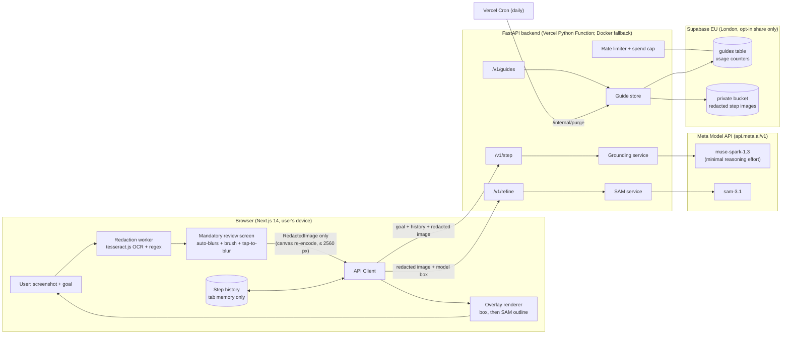

# ShowMe

> Screenshot + goal → one highlighted step at a time on your own screen. Detected private details are masked in your browser, and you review them before upload.

ShowMe is an on-screen assistant built for the **Meta Global AI Developer Hackathon (Indie track)**. It uses **`muse-spark-1.3`** for vision grounding and **`sam-3.1`** for segmentation outlines via the Meta Model API.

- **Live Web App**: [https://showme-web-delta.vercel.app](https://showme-web-delta.vercel.app)
- **Live API Health**: [https://showme-api-xi.vercel.app/v1/healthz](https://showme-api-xi.vercel.app/v1/healthz)
- **Evaluation Dashboard**: [https://showme-web-delta.vercel.app/eval](https://showme-web-delta.vercel.app/eval)

---

## 1. What ShowMe Does

When an older relative or friend gets stuck on an app or website, phone calls are painful ("What do you see now?") and remote desktop tools compromise privacy.

ShowMe is built for **the remote helper**:
When someone you help sends you a screenshot on WhatsApp or Messages, you drop it into ShowMe with what they want to do. ShowMe finds the exact button or link, masks detected private details client-side, and can generate an **expiring 7-day guide link** you can send back. One screenshot gives one step; for a second step you need a new screenshot from them. They open the link and view the highlighted screenshot with Previous and Next buttons. The guide is a picture, so tapping it does not operate their real app; they find the same control in their own app. The creator's delete key removes the guide at once. Access ends after 7 days; stored images are then removed by the next successful daily purge.

Privacy scope: ShowMe guarantees that only the redacted image is uploaded to its backend and to Meta. When a helper receives a screenshot over WhatsApp or Messages, they already hold the raw image from the messaging service, and ShowMe cannot undo that.

Confident self-helpers can also use ShowMe directly for their own tricky screens (cancelling subscriptions, complex government forms, obscure privacy settings).

1. **Screenshot & Goal**: Add a screenshot of what is currently on screen and state what you want to do (e.g. "cancel my subscription").
2. **On-Device Redaction**: Client-side OCR + regex masks emails, phone numbers, payment card numbers, UK postcodes, IBANs, and long digit strings. This detection is partial: it does not catch free text such as a visible typed password or a name. A mandatory review screen is where the user taps or brushes to hide anything else. The raw unredacted image is never uploaded.
3. **Step & Refinement**: The redacted screenshot is sent to `muse-spark-1.3` to identify the single next action. If `sam-3.1` segmentation agrees with the model bounding box, a precise outline highlight is drawn; otherwise, the bounding box is shown.
4. **Follow & Progress**: Find the highlighted element in your real app and tap it there, take the next screenshot, and repeat until the task is complete.
5. **Opt-in Sharing**: Share the guide steps with family or customers via a 7-day link that expires automatically. Guides can be shared starting right from Step 1.

---

## 2. How ShowMe Differs

Visual grounding and UI overlays are active areas (e.g. Microsoft Copilot Vision Highlights, Google Gemini Live, enterprise Digital Adoption Platforms). Here is how ShowMe differs, limited to what we could source. "Not documented" means we did not find it in the cited pages, not that the product lacks it:

| Capability | ShowMe | Microsoft Copilot Vision | Google Gemini Live | Enterprise DAPs (WalkMe, Pendo) |
| :--- | :--- | :--- | :--- | :--- |
| **Client-side redaction before upload** | Yes, partial: OCR + regex masks structured data, mandatory manual review covers the rest | Not documented | Not documented | Not reviewed |
| **Platforms** | Web app; the helper can use a screenshot from iOS, Android, Mac, or Windows | Windows, web (screen share), Copilot mobile app (camera) per Microsoft support | Android and iPhone/iPad (camera and screen sharing) per Google support | Not reviewed |
| **Shareable expiring guide link** | Yes (7-day expiry, creator delete key) | Not documented | Not documented | Not reviewed |
| **Reports `not_visible` and refusals** | Yes, with measured rates (76.7% on absent targets at prompt v3; still guesses in 23.3% of cases) | Not documented | Not documented | Not reviewed |

*Sources, all as of 2026-11-01: Microsoft, [Using Copilot Vision with Microsoft Copilot](https://support.microsoft.com/en-gb/topic/using-copilot-vision-with-microsoft-copilot-3c67686f-fa97-40f6-8a3e-0e45265d425f) (desktop Windows or web screen share; mobile app camera); Google, [Gemini Apps Help: Talk naturally with Gemini Live, iPhone & iPad](https://support.google.com/gemini/answer/15274899?hl=en&co=GENIE.Platform%3DiOS) (Gemini mobile app on iPhone/iPad, with camera and screen sharing). "One minute vs 20-minute phone call" represents our estimated product UX goal, not a measurement.*

---

## 3. Architecture

Thin, stateless FastAPI backend; all privacy-sensitive redaction occurs client-side in the browser before any network transmission; Meta models handle visual understanding.



### Data Storage & Privacy Boundary

| Data | Browser | Backend Memory | Backend Logs / Disk | Supabase Storage | Meta API |
| :--- | :--- | :--- | :--- | :--- | :--- |
| **Raw screenshot** | Yes (in memory only) | **Never** | **Never** | **Never** | **Never** |
| **Redacted image** | Yes | Request lifecycle | **Never** | Only if shared (7-day TTL) | Per request (Standard mode requested; Meta's data handling is per Meta's terms) |
| **Goal text** | Yes | Request lifecycle | **Never** (length only) | Only if shared | Per request |
| **Step instructions** | Yes | Request lifecycle | **Never** | Only if shared | Output generated |
| **IP address** | N/A | Request lifecycle | **Never** | Salted daily hash for rate limits (48 h TTL) | N/A |
| **Usage / Spend metrics** | N/A | N/A | Request latency, status, tokens, cost | Daily counter bucket | N/A |

---

## 4. Privacy Invariants

- **Private by Construction (PRIV-1)**: Raw screenshot bytes are never uploaded to ShowMe's backend or Meta. The TypeScript API client strictly requires a branded `RedactedImage` symbol generated solely by `apps/web/lib/redaction/redact.ts`. Verified by Playwright network interception tests.
- **Mandatory Human Review (PRIV-2)**: No API request can be dispatched until the user inspects the redacted screenshot on the review screen and clicks Continue. Cannot be skipped or disabled.
- **Zero Content Logging (PRIV-3)**: The backend is designed never to log screenshots, instructions, goal strings, or raw IP addresses.
- **Ephemeral (PRIV-4)**: Screenshots and session history stay in tab memory unless the user opts in to Share; no tracking cookies or localStorage image caches (Playwright-checked).
- **Standard Mode Only (PRIV-6)**: Uses Meta API standard mode. Contributor-mode models (`*-contributor`) are rejected by a settings validator so content rights remain with the user.

---

## 5. Measured Evaluation Results

Every figure below is generated directly from output logs in `eval/results/` and matches [`RESULTS.md`](eval/results/RESULTS.md) and [`report.md`](eval/results/2026-11-01-e2e-final/report.md):

| Suite | Dataset / Split | Model | Prompt | n | Accuracy | Metric |
| :--- | :--- | :--- | :--- | :--- | :--- | :--- |
| **ScreenSpot-v2** | Held-out (test) | `muse-spark-1.3` (minimal) | v3 | 1,172 | **89.9%** | Point inside ground-truth control box |
| **ScreenSpot-Pro** | Held-out (stratified) | `muse-spark-1.3` (minimal) | v3 | 300 | **62.0%** | Point inside control (high-res desktop/web) |
| **ScreenSpot-Pro** | Held-out (stratified) | `muse-wonder-1.0` (minimal) | v1 | 300 | **66.7%** | Point inside control (+3.0 pts at ~3× cost) |
| **Negatives (Honesty)** | Held-out absent probes | `muse-spark-1.3` (minimal) | v3 | 210 | **76.7%** | Correctly stated `not_visible` (161 / 210) |
| **Negatives (Safety)** | Safety probes | `muse-spark-1.3` (minimal) | v3 | 12 | **100.0%** | Correctly stated `refuse` (12 / 12) |
| **E2E 20-Task Suite** | Real live websites | `muse-spark-1.3` + `sam-3.1` | v3 | 20 | **60.0% (12/20)** on the 2026-11-02 re-run with fixed predicates (avg 4.45 steps) | Task predicate met; see Known Limitations 2 |
| **SAM Highlight Quality** | E2E step highlights | `sam-3.1` agreement | v2 | 74 | **not run** (all 74 rating cells empty; no claim vs boxes) | Automated pipeline recorded 53 SAM outlines, 9 model boxes, 12 none; sheet in `eval/e2e/highlight_ratings.csv` |

*Full evaluation reports and raw predictions: [`eval/results/RESULTS.md`](eval/results/RESULTS.md) and [`eval/results/2026-11-01-e2e-final/report.md`](eval/results/2026-11-01-e2e-final/report.md).*

> **Prompt Version Note**: Shipped production runs prompt v3 (`pvv3`, frozen 2026-11-02), and the benchmark rows above are that prompt's held-out runs. Prompt v3 added a label-match gate for `ok`; on the dev splits it scored honesty 70.0% vs v2 60.0% and ScreenSpot 94.0% vs 92.0% (MEMORY D52). Historical v1 runs remain in `eval/results/` (ScreenSpot-v2 90.7%, Pro 63.7%, honesty 62.4%). The SAM ablation is still the v1 run and is labelled as such.

---

## 6. Known Limitations

In keeping with our transparency principles:
1. **Absent-Target Honesty**: On held-out screens where the requested target is not present, `muse-spark-1.3` (prompt v3) says `not_visible` 76.7% of the time (161/210), falling short of our 90% target. In 23.3% of absent cases, the model still highlights something. Prompt v1 scored 62.4% on the same probes; the v3 label-match gate was kept by a pre-registered dev-split rule (D52).
2. **E2E Task Set Scope**: The 2026-11-02 re-run on the frozen prompt v3 with audited predicates (`eval/results/2026-11-02-e2e-bb543ba-04574992c7/`) records 12/20 (60.0%), avg 4.45 steps. The earlier 14/20 run's 4 suspect passes (predicate matched a video title, search suggestions or a sign-in page) were fixed and covered by offline tests in `eval/e2e/predicate.test.mjs`; in the re-run e2e-19 fails honestly and e2e-09 passes. The 8 failures include one model 502 and one 504 (recorded in the report). The tasks were also used during iterative development, so no unseen held-out E2E task suite has been run yet.
3. **Free-form Text Inputs**: Regex covers structured PII (emails, cards, phones, postcodes, IBANs), but unstructured personal text (names, custom notes) depends on the user's manual brush on the review screen.
4. **Dense Desktop Interfaces**: Accuracy drops to 62.0% on high-resolution professional software (ScreenSpot-Pro, prompt v3) with tightly packed toolbars.
5. **Live Web E2E Failure Modes**: 6 of 20 live web tasks failed due to anti-bot defenses (e.g. Royal Mail Access Denied), stubborn third-party cookie consent banners, and file download triggers without in-page success states.
6. **Mobile Browser OCR**: Laptop Chrome OCR executes in 106–214 ms; mid-range mobile phone browser OCR timing has not been verified in the field yet (marked **not run** per RULES.md transparency policy rather than estimated).
7. **Human Highlight Quality Rating**: 74 step screenshots and refine outcomes from the 20-task E2E suite are extracted into `eval/e2e/highlight_ratings.csv` (53 SAM outlines, 9 model boxes, 12 no-highlight/scroll states), but human evaluation is currently marked **not run** pending external founder grading.

---

## 7. Development & Quickstart

### Prerequisites
- Python 3.11+ with [`uv`](https://github.com/astral-sh/uv)
- Node.js 20+ with [`pnpm`](https://pnpm.io/)
- Meta Model API key (`MODEL_API_KEY`) in `.env` (copy from `.env.example`)

### Commands

```bash
# Install dependencies for web, backend, and eval
make setup

# Run local development servers (Web on :3000, API on :8000)
make dev

# Run unit and integration tests (backend pytest + eval pytest + web vitest)
make test

# Run linters and typecheckers (ruff, mypy strict, eslint, tsc)
make lint

# Run Playwright browser test suite (41 tests, including axe accessibility checks)
pnpm --filter web test:e2e

# Run the 10-sample live grounding smoke test (~$0.05)
make smoke

# Run evaluation harness
make eval SUITE=screenspot-v2 [N=100] [MODEL=muse-spark-1.3] [EFFORT=minimal]
```

---

## 7. Project Structure

```text
showme/
├── apps/web/                 # Next.js 14 App Router, TypeScript strict, Tailwind CSS
│   ├── app/                  # Pages: /, /app, /eval, /g/[token]
│   ├── components/           # UI components, Overlay, A11yControls, GuideStepper
│   └── lib/redaction/        # tesseract.js worker, PII regex patterns, canvas redact
├── backend/                  # FastAPI backend (Vercel Python Function & local Docker)
│   ├── showme/core/          # Pure Python logic: prompts, schema, grounding, SAM, pricing
│   ├── showme/api/           # FastAPI routes: /v1/step, /v1/refine, /v1/guides
│   └── migrations/           # 001_guides.sql (Supabase RLS & counter tables)
├── eval/                     # Evaluation harness for ScreenSpot & 20-task E2E suite
│   ├── showme_eval/          # Evaluation runner, metrics, cache, calibration
│   ├── e2e/                  # Playwright 20-task automated suite and task definitions
│   └── results/              # Immutable evaluation logs, predictions, and spend records
├── docs/                     # PRD, ARCHITECTURE, DESIGN, RULES, REQUIREMENTS, PHASES, MEMORY
└── .learnings/               # Daily founder briefings, interview Q&A drills, step log
```

---

## 8. Licence & Citations

- **Licence**: MIT — see [LICENSE](LICENSE).
- **Meta Models**: Grounding powered by `muse-spark-1.3`; segmentation outlines powered by `sam-3.1`.
- **Benchmark**: ScreenSpot dataset (Cheng et al., 2024).
