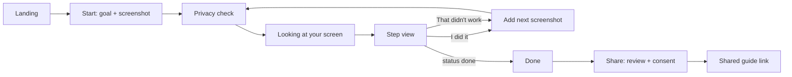

# Design: ShowMe

Status: draft for founder approval · Last updated: 2026-10-27
Requirements referenced: FLOW-*, A11Y-*, WEB-* in [REQUIREMENTS.md](REQUIREMENTS.md).

## 1. Direction: ink and highlighter

**The subject's own vernacular.** When a relative helps someone with a confusing app today, they print or photograph the screen and circle the button in highlighter pen, sometimes with a number next to it. That marker circle on a real screen is ShowMe's whole idea, so it is the visual identity: calm ink-blue paper, and one bright highlighter ring that says "press here".

**Spend boldness in one place.** The highlighter ring and step number are the only loud elements in the product and on the landing page. Everything else is quiet, large, and plain, so the eye goes to the ring.

**Audience shapes every choice.** Readers may be 70+, on a phone, worried about pressing the wrong thing. So: one instruction at a time, very large type, high contrast, no jargon, nothing moves unless it means something, and every state says what to do next.

Review against generic defaults (done before writing this spec): no cream background, no terracotta, no acid accent on near-black, no card grid with identical shadows, no all-caps eyebrows, no middle-dot meta lines, no arrow suffixes on buttons, no monospace labels. Numbered markers are used only for real steps.

## 2. Tokens

### Colour

| Token | Hex | Role |
| --- | --- | --- |
| `ink` | `#16264A` | Text, outer stroke of the ring, primary buttons |
| `paper` | `#FFFFFF` | Page background |
| `mist` | `#E9EEF6` | Panels, review-screen background, quiet surfaces |
| `highlighter` | `#FFD43B` | The ring, step-number badge, focus ring. Never used for text on white. |
| `caution` | `#B3261E` | Caution banner text and icon (always with icon + words, never colour alone) |
| `done` | `#1D6B45` | Completion state |
| `scrim` | `rgba(22,38,74,0.55)` | Dims everything outside the target |
| `sun` | `#FFF4C2` | Soft highlighter tint: hero demo surface, "families" section (D38) |
| `sage` | `#E3F1E8` | Soft done tint: privacy section, done screen (D38) |
| `blush` | `#FBE9E7` | Soft caution tint: caution banner background only (D38) |

Section tints always carry `ink` text (all ≥ 12:1) and become `paper` in high-contrast mode. One full `ink` colour block (paper text) is allowed once per page, for the landing numbers band.

Contrast (computed with the WCAG 2.x formula on 2026-10-27; re-verify with axe): `ink` on `paper` 14.9:1; `ink` on `mist` 12.8:1; `ink` on `highlighter` 10.4:1; `caution` on `paper` 6.5:1; `done` on `paper` 6.5:1. `highlighter` on `paper` is only 1.4:1, which is why the ring always carries an `ink` outer stroke (§3). High-contrast mode swaps `mist` to `paper`, thickens all strokes by 2 px, and removes the scrim tint (pure black at 0.65).

### Type

One family: **Atkinson Hyperlegible Next** (SIL OFL, from Google Fonts), **self-hosted** through `next/font` so browsers never call Google at runtime (PRIV-8). It was designed for low-vision readers, with distinct letterforms for I/l/1 and O/0, which matters when an instruction names a button label.

| Style | Size / line-height | Weight | Use |
| --- | --- | --- | --- |
| Instruction | 28 / 36 (mobile 24 / 32) | 700 | The one sentence per step |
| Display | 56 / 60 (mobile 40 / 44) | 800 | Landing headline only |
| Title | 32 / 40 | 700 | Screen titles |
| Body | 20 / 30 | 400 | Explanations |
| Small | 18 / 26 | 400 | Minimum size anywhere (A11Y-1) |
| Badge numeral | 24 | 800, tabular figures | Step number in the ring badge |

Line length ≤ 60 characters for body and instruction text. Sentence case everywhere.

### Space, shape, motion

- 8 px grid; touch targets ≥ 48 px (A11Y-7 needs 44).
- Radii carry meaning: buttons 12 px; panels 16 px; the ring follows the element's own shape (rounded rect from the model box, exact outline from SAM). No shadows except the scrim.
- Motion: one entrance per step (ring draws on in 300 ms, badge pops in 150 ms after). Box-to-outline swap is a 200 ms crossfade. No looping pulse. `prefers-reduced-motion`: all of this becomes instant (A11Y-5).

## 3. The overlay (FLOW-4 to FLOW-7)

The overlay is drawn in an SVG layer over the user's redacted screenshot, scaled to fit the viewport. Coordinates from the API are image pixels; the SVG `viewBox` equals the image size, so no maths in components.

```text
 ┌──────────────────────────────────────────────┐
 │░░░░░░░░░░░░░░░░ scrim 55% ░░░░░░░░░░░░░░░░░░│
 │░░░░░░░░░ ( 2 )░░░░░░░░░░░░░░░░░░░░░░░░░░░░░░│   badge: highlighter disc, ink numeral,
 │░░░░░░░░░╔═════════════════════╗░░░░░░░░░░░░░│   sits outside the top-left corner,
 │░░░░░░░░░║ Cancel subscription ║░░░░░░░░░░░░░│   flips to stay on screen
 │░░░░░░░░░╚═════════════════════╝░░░░░░░░░░░░░│
 │░░░░░░░░░░░░░░░░░░░░░░░░░░░░░░░░░░░░░░░░░░░░░│   target area is cut out of the scrim
 └──────────────────────────────────────────────┘
```

**Ring construction** (readable on any screenshot, light or dark): 2 px `paper` inner hairline, 6 px `highlighter` stroke, 2 px `ink` outer stroke, 6 px padding around the target.

| State | Ring | Badge | Extra |
| --- | --- | --- | --- |
| `ok`, model box | Rounded rect from the box | Step number | Ring draws on |
| `ok`, SAM outline | SAM path, same strokes | Step number | Crossfade from the box; no layout shift |
| `unsure` | Dashed (12 / 8) | "?" | Banner: "I think it is this one. Check before you tap." + "Try another way" |
| `not_visible` | None, no scrim | None | Edge arrow in `scroll_direction` + the model's hint ("It is probably further down. Scroll down, then take a new screenshot.") |
| `done` | None | Tick | Completion screen |
| `refuse` | None | None | Calm explanation panel |
| Small target (box < 32 px either side) | Normal ring | Normal | 2.5x magnifier inset near the target, joined by a 2 px ink line |

**Tap/type/scroll hints** sit inside the instruction card, not on the screenshot: a tap icon, a keyboard icon with `type_text` in a large chip ("Type: cancel"), or a scroll arrow.

## 4. Screens and flow



### 4.1 Start (`/app`)

```text
 ┌───────────────────────────────┐
 │ ShowMe                 Aa  ◐  │  Aa = text size, ◐ = high contrast
 │                               │
 │ What do you want to do?       │
 │ ┌───────────────────────────┐ │
 │ │ cancel my subscription    │ │  goal input, 24 px, placeholder rotates real examples
 │ └───────────────────────────┘ │
 │ ┌───────────────────────────┐ │
 │ │   Add a screenshot        │ │  big drop zone: paste, drag, or choose file
 │ │   or paste it here        │ │
 │ └───────────────────────────┘ │
 │ How do I take a screenshot?   │  opens device-specific help (iPhone, Android, Windows, Mac)
 │ Your screenshot stays on this │
 │ device until you check it.    │
 └───────────────────────────────┘
```

### 4.2 Privacy check (mandatory, PRIV-2)

```text
 ┌───────────────────────────────┐
 │ Check what we will send       │
 │ We hid 3 things that looked   │
 │ private. Tap anything else    │
 │ you want hidden.              │
 │ ┌───────────────────────────┐ │
 │ │ [screenshot with solid    │ │  auto blocks shown in ink with a lock glyph;
 │ │  blocks over private text]│ │  tap a text line to hide it; brush tool
 │ └───────────────────────────┘ │
 │ [Brush] [Undo] [Zoom]         │
 │ ┌───────────────────────────┐ │
 │ │ Looks private. Continue   │ │  primary button
 │ └───────────────────────────┘ │
 └───────────────────────────────┘
```

The only thing that leaves the device is what this screen shows. The copy says so in one line under the image.

### 4.3 Looking at your screen

Skeleton of the step view with the screenshot visible, plus live text that changes with progress: "Looking at your screen" → "Finding the button" (box arrives) → "Drawing the outline". Cancel button. If > 10 s: "This is taking longer than usual." No spinner-only screens.

### 4.4 Step view

Desktop: screenshot left (flex), instruction card right (min 380 px). Mobile: screenshot top (pinch-zoom), instruction card docked at the bottom as a sheet that never covers the ring (the view scrolls the ring into the upper 60%).

```text
 ┌──────────────────────────────┬──────────────────────┐
 │                              │ Step 2               │
 │   [screenshot + overlay]     │ Tap "Cancel          │
 │                              │ subscription", the   │
 │                              │ red button under     │
 │                              │ your card details.   │
 │                              │ [🔊 Read it to me]   │
 │                              │ ┌──────────────────┐ │
 │                              │ │ I did it, next   │ │
 │                              │ └──────────────────┘ │
 │                              │ That didn't work     │
 │                              │ Start over           │
 └──────────────────────────────┴──────────────────────┘
```

Caution (FLOW-10): a `caution`-coloured banner with a warning icon above the instruction: "Careful: this page asks for a gift card. Real companies do not ask for gift cards."

### 4.5 Done and Share (FLOW-8, PRIV-5)

Done: tick, "You did it: subscription cancelled" (uses the goal), options: "Share these steps", "Start something new". Share: shows every step image again with "Check each picture before sharing", consent checkbox "I understand anyone with the link can see these pictures for 7 days", button "Create link". Result: copy button, expiry date in words ("until Tuesday 10 November"), "Delete now" link.

### 4.6 Shared guide (`/g/[token]`)

Read-only stepper of the same overlay view. Banner: "Shared guide. Deletes itself on Tuesday 10 November." No branding chrome beyond the logo, `noindex`.

### 4.7 Errors and limits (copy is direction, not apology)

| Situation | Copy |
| --- | --- |
| Rate limited | "You have used ShowMe a lot this hour. Try again at 3:40 pm." |
| Daily spend cap | "ShowMe is resting until tomorrow so it stays free. Your screenshot was not sent." |
| Model error | "That did not work on our side. Your screenshot was not saved. Try again." |
| Image too big / wrong type | "This file is not a picture we can read. Use a PNG or JPG screenshot." |
| No text found by OCR | "We could not find any text to hide automatically. Check the picture and hide anything private." |

## 5. Accessibility (A11Y-1 to A11Y-7)

- Text size control (100 / 125 / 150%) and high-contrast toggle on every screen, tab-scoped.
- Keyboard: `Tab` order follows reading order; `Enter` on the drop zone opens the file picker; `Ctrl/Cmd+V` pastes anywhere on /app; `N` = I did it, `R` = read aloud, `Esc` = cancel. Focus ring: 3 px `highlighter` + 2 px `ink`.
- Screen readers: instruction card is `aria-live="polite"`; the screenshot has `alt` = "Your screenshot. Step 2 target: Cancel subscription button, lower left of the page."; the overlay SVG is `aria-hidden`.
- Read aloud uses the browser's on-device `speechSynthesis` (no audio leaves the device).
- No information by colour alone (caution has an icon and the word "Careful").
- Target sizes ≥ 48 px; no hover-only controls.
- Tested with axe in Playwright, keyboard-only run, VoiceOver smoke test, 200% zoom.

## 6. Landing page (`/`, WEB-1)

One orchestrated moment: the hero **is** the product. A real (synthetic, clearly fake data) billing screenshot sits under the headline; on load the ring draws onto "Cancel subscription" and the instruction types in beside it. Reduced motion shows the final state.

Outline, in order:

1. **Hero.** Headline "Stuck on a screen? ShowMe points to the next tap." Sub: "Add a screenshot, say what you want to do, and see exactly where to press. Private details are hidden on your device before anything is sent." Primary button "Try it with a screenshot". Secondary "Watch the 2 minute demo".
2. **How it works.** A real sequence, so numbered: 1 Add a screenshot and your goal. 2 Check the hidden details. 3 Follow one highlighted step at a time.
3. **Private by design.** Three plain statements with the evidence link: the raw picture never leaves your device; nothing is kept unless you share; shared guides delete themselves after 7 days.
4. **How often it is right.** Live numbers from `RESULTS.md` (accuracy on ScreenSpot-v2 and -Pro, E2E task success, honesty rate) with a link to `/eval` and the raw files. Includes the weakest number, not only the best.
5. **For families.** Share a guide with a relative.
6. **For companies.** "ShowMe for your help centre": short pitch, widget mock, contact link (mailto; no form that stores emails).
7. **Built with Meta models.** Muse Spark 1.3 finds the step; SAM 3.1 draws the outline. One sentence each.
8. **Footer.** GitHub, privacy page, limitations, hackathon note.

## 7. Demo video script (2:30 target, 3:00 max)

| Time | Picture | Voice-over |
| --- | --- | --- |
| 0:00 to 0:15 | Phone call style caption; a real-looking billing page; cursor hesitating | "My dad called again: 'it wants me to press something, but where?' Help that cannot see your screen does not help." |
| 0:15 to 0:30 | Landing hero animation | "ShowMe looks at your actual screen and points to the one thing to press next." |
| 0:30 to 0:55 | Paste screenshot, type "cancel my subscription", privacy check auto-hides email and card, user brushes the name | "Before anything is sent, ShowMe hides emails, phone and card numbers on your device. You check it and hide anything else." |
| 0:55 to 1:25 | Step 1 ring + instruction, read aloud; box swaps to SAM outline; next screenshot; step 2; caution banner on a payment page; done | "Muse Spark reads the screen and picks one step. SAM 3.1 draws the outline around the exact button. One step at a time, until it is done." |
| 1:25 to 1:45 | `not_visible` case with scroll arrow; `unsure` dashed ring | "When it cannot see the button, it says so and tells you where to look. It never guesses silently." |
| 1:45 to 2:00 | Share flow, link with expiry | "Share the steps with family. The link deletes itself after seven days." |
| 2:00 to 2:20 | `/eval` page numbers, terminal running `make eval` | "We measured it on public benchmarks and 20 real tasks. Here is how often it is right, and where it is not." |
| 2:20 to 2:30 | "For companies" section, logo | "Next: ShowMe inside help centres, so customers get pointed to the answer instead of opening a ticket." |

All footage from the live product (RULES §2). Captions burned in for silent autoplay.

## 8. Copy rules

- Name things by what the user sees: the button's label and where it is ("the blue Save button at the bottom"), never "CTA", "kebab", "hamburger", "modal", "AI".
- One action per instruction, max 25 words, starts with a verb.
- Buttons say what happens: "Create link", "I did it, next", "Hide this".
- Errors say what happened and what to do; no "Oops", no apologies.
- Never ask the user to reveal anything hidden (RULES P8).
